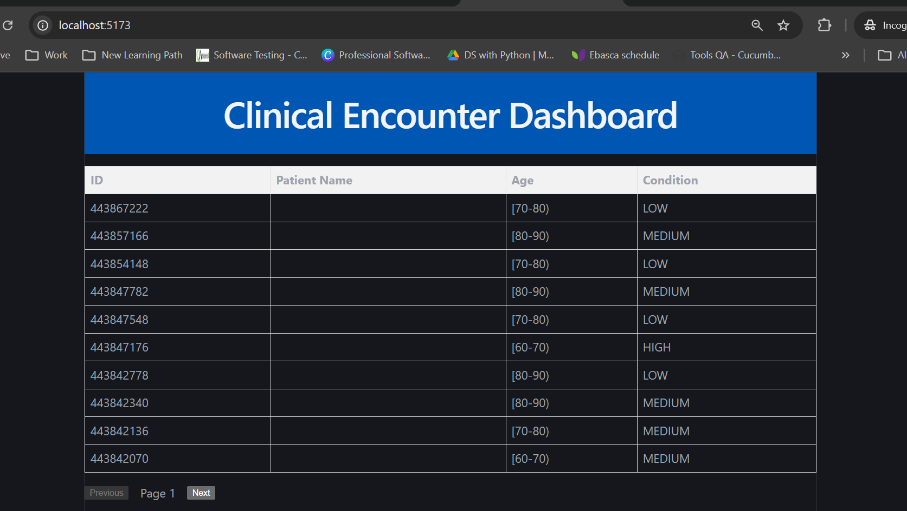

# Clinical Encounter Dashboard (Frontend)

A React + TypeScript application built with Vite that provides a user interface for monitoring and paginating patient clinical encounter records.

## Features
- **Header Navigation**: Custom application branding (`Header.tsx`).
- **Data Table**: Tabular view displaying patient ID, name, age, and risk level (`PatientTable.tsx`, `PatientRow.tsx`).
- **Paginated Data Fetching**: Custom hook (`usePaginatedFetch.ts`) handling state management and API integration.
- **Pagination Controls**: Page navigation controls (`Pagination.tsx`).

## Tech Stack
- **Framework**: React + TypeScript (Vite)
- **Styling**: CSS Modules / Custom CSS

## Getting Started

### Prerequisites
Ensure the backend FastAPI service is running on `http://localhost:8000`.

### Installation & Run
1. Install dependencies:
   ```bash
   npm install

# Clinical Encounter Dashboard (Frontend)




